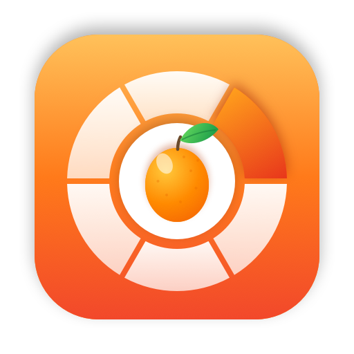
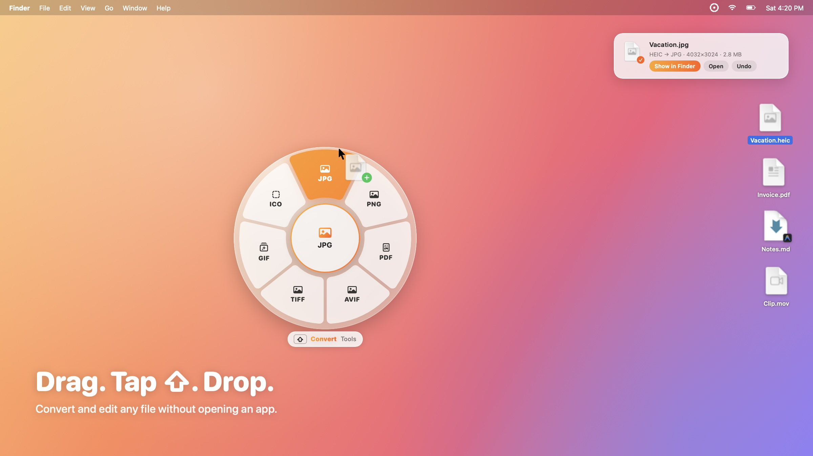
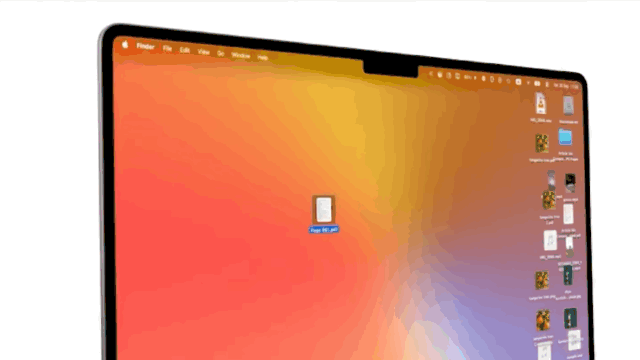
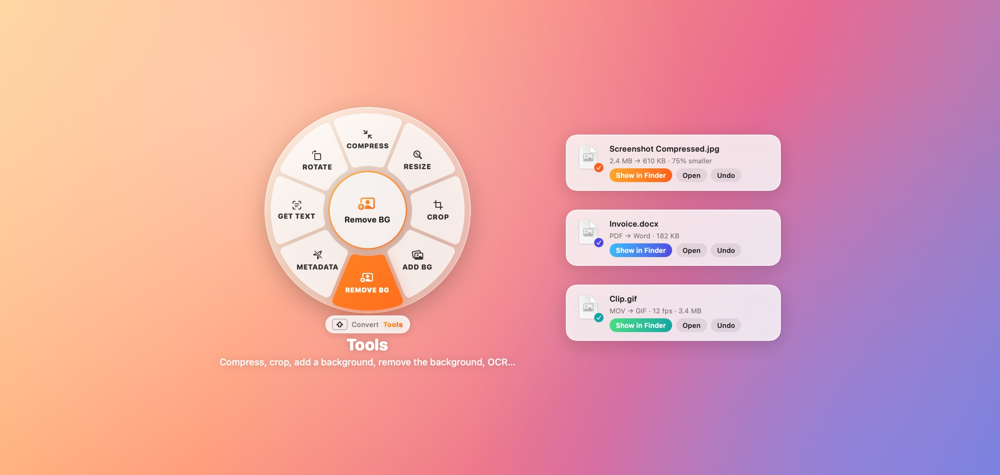
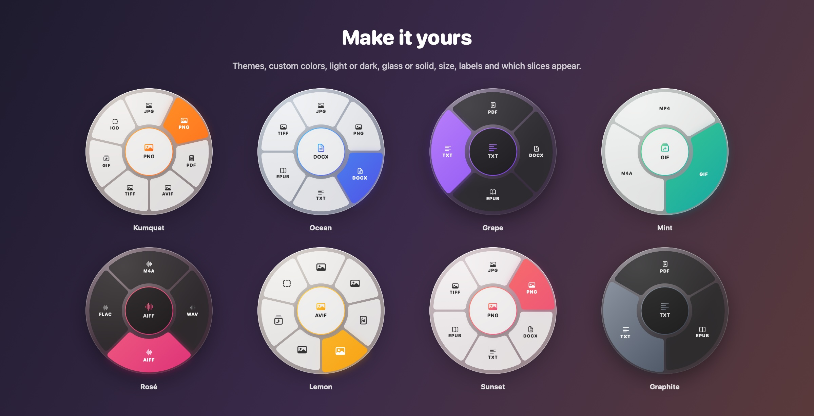
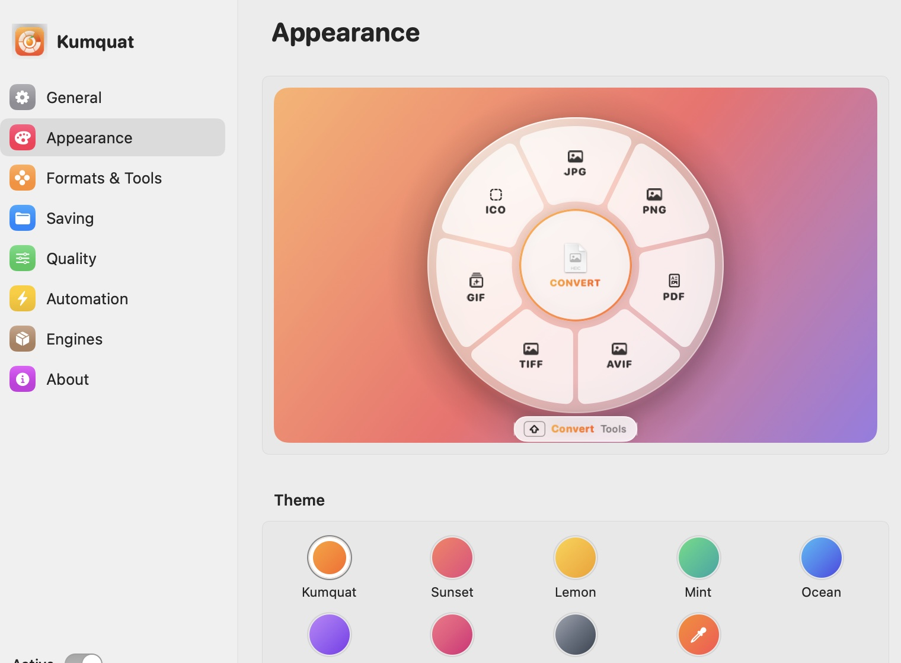

<div align="center">

**English** · [Español](docs/readme/README_es.md)



# Kumquat

### Drag a file. Tap ⇧. Drop it on a format.

**A free, open-source file converter that lives inside your drag-and-drop.**<br/>
Images, PDFs, documents, video and audio, converted and edited without opening an app.

[](#install)
[](Package.swift)
[](LICENSE)
[](https://github.com/iandifilippo/Kumquat/releases/latest)
[](https://github.com/iandifilippo/Kumquat/actions/workflows/ci.yml)


**[Website](https://iandifilippo.github.io/Kumquat/)** · [Install](#install) · [How it works](#how-to-use) · [What it converts](#what-it-converts) · [Engines](#optional-engines) · [Automation](#automation-and-command-line) · [Make it yours](#make-it-yours) · [FAQ](#faq)

<code>curl -fsSL https://raw.githubusercontent.com/iandifilippo/Kumquat/main/install.sh | bash</code>

<br/><br/>



<br/>



</div>

---

Converting a file on a Mac usually means opening Preview, finding *Export…*, picking a format and a folder. Kumquat cuts that to one gesture: **grab any file, move it a little, tap Shift, and drop it on a slice of the ring that appears under your cursor.** The converted copy lands next to the original. The original is never touched.

It's a native Swift app with no dependencies. Your files never leave your Mac: no accounts, no uploads, no analytics.

**Highlights:** 60+ formats out of the box (images, PDF, Word, Markdown, EPUB, CSV/Excel/JSON, subtitles, video, audio, ZIP/RAR/7Z) · on-device background removal and OCR · Crop, Add Background, Resize, Compress, Merge, Split, Protect · progress right inside the ring · watch folders · a `kumquat` command · a ⌃⌥K shortcut for the Finder selection · 9 languages · fully themeable.

## Install

**One line in Terminal** (recommended, no security warning):

```bash
curl -fsSL https://raw.githubusercontent.com/iandifilippo/Kumquat/main/install.sh | bash
```

It downloads the latest release, copies **Kumquat** into Applications, adds the `kumquat` command and opens it ([read the script](install.sh)). Run it again to update, or use **Update** in the menu bar when Kumquat tells you a new version is out.

**Or download it yourself:** grab `Kumquat-x.y.z.dmg` from the [latest release](https://github.com/iandifilippo/Kumquat/releases/latest), open it and drag Kumquat into Applications. The app is universal (Apple Silicon and Intel) and needs **macOS 14 Sonoma or later**.

> [!NOTE]
> **First launch from the .dmg.** Kumquat isn't notarized by Apple yet, so macOS says it *"cannot verify"* the app. Open it once, click **Done**, then go to **System Settings → Privacy & Security** and click **Open Anyway**. Or run `xattr -dr com.apple.quarantine /Applications/Kumquat.app`. The full source is in this repo.

Kumquat lives in the menu bar (the little segmented ring) and has no Dock icon unless you turn one on.

## How to use

1. **Grab a file** (or several) in Finder or on the desktop and **move it a little**, keeping the mouse button or trackpad pressed. macOS only starts a drag once the file moves.
2. **Tap ⇧ Shift** (press and release) while still holding the file. The ring appears instantly under your cursor.
3. **Drop the file on a slice.** The center of the ring shows the progress, then a ✓. A notification shows the result with **Show in Finder**, **Open** and **Undo**.

Tap **⇧** again while dragging to switch between **Convert** and **Tools**. Drop on the center, or let go anywhere else, to cancel.

> [!TIP]
> If nothing appears, make sure the file is actually being dragged (you see its ghost under the cursor) before you tap ⇧. Dragging straight out of the Photos app doesn't work because Photos doesn't hand over a file while dragging; drag the photo to the desktop first.

No drag needed? Kumquat also opens from:

- **⌃⌥K** with files selected in Finder
- dropping files on the **menu bar icon**
- the menu bar → **Convert a File…** (and **Recent** to find what you converted)
- Finder's right-click → **Services → Convert with Kumquat**
- **Open With → Kumquat**

In those cases the ring opens in click mode: click a slice, click the center (or press Tab) to switch pages, Esc to close.

<div align="center">

</div>

## What it converts

| You drop | Convert to | Tools |
|---|---|---|
| **Images** — HEIC, JPG, PNG, WebP, AVIF, TIFF, GIF, BMP, PSD, SVG, RAW, JPEG XL… | JPG · PNG · HEIC · AVIF · TIFF · GIF · BMP · ICO · ICNS · PSD · **PDF** (several images → one PDF) · WebP¹ | **Compress** · **Resize** · **Crop** · **Add BG** (padding, corners, shadow, ratio) · **Remove BG** (on-device AI for photos, color-keying for signatures and logos on plain paper) · **Get Text** (OCR, copied to the clipboard) · **Metadata** (strip location & camera data) · Rotate · Flip · B&W · ZIP |
| **PDF** | JPG / PNG / TIFF (one per page) · TXT · Word (DOCX) · EPUB · RTF · HTML | **Compress** (balanced or strongest; Ghostscript² when installed) · **Merge** · **Split** · **Rotate** · **Protect** (password) · **Get Text** (OCR for scans) · **One Image** (all pages as one tall picture) |
| **Documents** — TXT, Markdown, RTF, Word (DOC/DOCX), HTML, ODT | PDF · DOCX · EPUB · TXT · RTF · HTML · ODT | ZIP |
| **E-books** — EPUB | PDF · DOCX · TXT · HTML · RTF | ZIP |
| **Spreadsheets & data** — CSV, TSV, XLSX, JSON, PLIST | XLSX · CSV · JSON · TSV · HTML table · PDF table · PLIST ↔ JSON | ZIP |
| **Subtitles** — SRT, VTT | SRT · VTT · TXT (transcript) | — |
| **Video** — MOV, MP4, M4V; WebM, MKV, AVI, FLV, WMV…¹ | MP4 · MOV · **GIF** · **M4A** (extract audio) · M4V; MP3 · WebM · MKV · AVI¹ | **Compress** (HEVC 1080p) · **Mute** · **Frames** (every frame or N per second, into a folder) |
| **Audio** — MP3, WAV, AIFF, M4A, FLAC; OGG, OPUS, WMA…¹ | M4A · WAV · AIFF · FLAC · CAF; MP3 · OGG · OPUS¹ | — |
| **Archives** — ZIP, RAR, 7Z, TAR, TAR.GZ, GZ, BZ2, XZ… | ZIP · TAR.GZ | **Extract** |
| **Folders, or any mix of files** | — | **ZIP** (images + PDFs can also **Merge** into one PDF) |
| **Office** — XLS, ODS, Numbers, PPT, PPTX, Keynote, Pages³ | PDF · XLSX · CSV · PPTX | — |

¹ needs [FFmpeg](#optional-engines) (WebP: `brew install webp`) · ² [Ghostscript](#optional-engines) · ³ [LibreOffice](#optional-engines). Everything else works out of the box.

Every result is saved next to the original (or in a subfolder or a folder you choose), with a fresh name like `Photo 2.jpg` if the name is taken. Notifications tell you what changed: *"2.4 MB → 610 KB · 75% smaller"*, *"PDF → DOCX · 182 KB"* or *"143 words · copied to the clipboard"*. Compressing something that can't get smaller saves nothing and says so.

## Optional engines

Kumquat converts most files with what macOS already has. These free tools unlock more formats. Kumquat **never downloads anything**; install them yourself and they're picked up automatically (Settings → Engines shows what's found).

| Engine | Install | Adds |
|---|---|---|
| FFmpeg | `brew install ffmpeg` | WebM, MKV, AVI, FLV, WMV… in and out; MP3, OGG, OPUS; GIFs and frames from any video |
| WebP | `brew install webp` | Save images as WebP |
| Ghostscript | `brew install ghostscript` | Much smaller PDFs that keep selectable text |
| LibreOffice | [libreoffice.org](https://www.libreoffice.org/download/download-libreoffice/) | Excel, PowerPoint, Keynote, Numbers and Pages → PDF; Word → PDF with exact layout |

## Automation and command line

- **Watch folders** (Settings → Automation): pick a folder and an action, for example *Convert to JPG*. Every file that lands there is converted, and the original can move into an *Originals* subfolder.
- **⌃⌥K** opens the ring for whatever is selected in Finder.
- **The `kumquat` command** (Settings → Automation → Install, or the install script):

```bash
kumquat convert photo.heic --to jpg
```

```bash
kumquat convert *.png --to webp -o converted --quality 80
```

```bash
kumquat tool compress IMG_*.jpg
```

```bash
kumquat watch ~/Downloads/Inbox --to pdf --move-originals
```

Run `kumquat help` for every command and tool, `kumquat formats <file>` to see what a file can become, and `kumquat engines` to see which engines are installed.

## Make it yours

<div align="center">

</div>

Everything about the ring is adjustable in **Settings** (menu bar → Settings…), with a live preview:

- **Themes:** Kumquat, Sunset, Lemon, Mint, Ocean, Grape, Rosé, Graphite, or **Custom** with your own two-color gradient
- **Material:** Frosted glass, Liquid Glass (macOS 26) or Solid; light, dark or match the system
- **Ring size**, **slice opacity**, labels (icon + text, text only, icon only), animations, trackpad haptics
- **Trigger key:** ⇧ Shift, ⌥ Option, ⌃ Control or ⌘ Command, as a tap toggle or hold-to-show
- **Formats & Tools:** choose exactly which slices appear for each kind of file, and in which order
- **Saving:** next to the original, in a subfolder, or a fixed folder; reveal in Finder; move originals to the Trash (Undo puts them back)
- **Quality:** conversion and compression quality, max size, keep or drop metadata, PDF page DPI and compression strength, frames per second, GIF frame rate, width and length
- **Language:** English, Español, Português, Français, Deutsch, Italiano, 日本語, 한국어 and 简体中文 (more welcome, see [Translating](#translating))

<div align="center">

</div>

## FAQ

<details>
<summary><b>Does it need Accessibility or Screen Recording permission?</b></summary>

No. Kumquat notices drags with a global mouse monitor and the system drag pasteboard, and reads the modifier keys with `NSEvent.modifierFlags`. Neither needs special permission. It never reads the screen or your keystrokes.
</details>

<details>
<summary><b>Does anything get uploaded?</b></summary>

No. Conversions use Apple's own frameworks (ImageIO, PDFKit, AVFoundation, Vision, AppKit), the built-in `afconvert`, `zip` and `tar`, and the optional engines if you installed them. Background removal and OCR run on-device. The only network request is an update check that asks GitHub for the latest version number; turn it off in Settings → About.
</details>

<details>
<summary><b>I tap Shift and nothing happens.</b></summary>

The ring only opens during a real drag: press on the file, move it a little until you see it under the cursor, then tap ⇧ while still holding. Also check that Kumquat isn't paused (menu bar icon). Dragging from the Photos app doesn't hand over a file; drag the photo to the desktop first.
</details>

<details>
<summary><b>Shift already does something in my app while dragging.</b></summary>

Pick another trigger key in **Settings → General**, or switch to *Show only while the key is held*.
</details>

<details>
<summary><b>Why don't I see WebP, MP3 or WebM?</b></summary>

macOS can read them but can't write them on its own. Install the free encoders (`brew install webp ffmpeg`) and the slices appear. AVIF and HEIC are always available and are usually smaller than WebP anyway.
</details>

<details>
<summary><b>How do I uninstall it?</b></summary>

Quit it from the menu bar and move `/Applications/Kumquat.app` to the Trash. To also remove its settings: `defaults delete io.github.iandifilippo.kumquat`.
</details>

## Build from source

Requires Xcode 16 or later (Xcode 26 for Liquid Glass).

```bash
git clone https://github.com/iandifilippo/Kumquat.git
```

```bash
cd Kumquat && scripts/build-app.sh --dmg
```

That produces `build/Kumquat.app` (universal) and `build/Kumquat-<version>.dmg`. Other handy commands:

| Command | What it does |
|---|---|
| `swift test` | Runs the conversion test suite (real files in, real files out) |
| `swift run Kumquat` | Runs the app from the command line |
| `swift scripts/make-icon.swift` | Redraws the app icon |
| `.build/debug/Kumquat --render-screenshots docs/assets` | Re-renders the README images |
| `.build/debug/Kumquat --render-ui /tmp/ui photo.jpg` | Renders every window (Settings panes, editors, onboarding) for review |
| `scripts/check-translations.py` | Lists strings missing a Spanish translation |

### Project layout

```
Sources/
  KumquatCore/      Conversions and tools. No UI, fully tested.
    Engine.swift      Runs a ring action on files
    Images / PDFs / Documents / Media / Vision / Background
    Archives / DataFiles / Subtitles / EPUB / Engines (FFmpeg, LibreOffice, Ghostscript)
    FolderWatcher / CropGeometry
  Kumquat/          The app
    Drag/             Detects file drags and the trigger key
    Ring/             The radial menu, its glass and the drop target
    Runner/           Runs actions, progress and result notifications
    Editors/          Crop, Add BG, Resize and PDF password windows
    Settings/         Preferences, themes and the Settings window
    Automation/       Watch folders, ⌃⌥K shortcut, update check
    CLI/              The `kumquat` command
    Localization/     Translations (9 languages)
Tests/KumquatCoreTests/
scripts/            build-app.sh, make-icon.swift, check-translations.py
```

## Translating

Strings are written in English in the code and looked up in the tables in [`Localization/`](Sources/Kumquat/Localization). To add a language, copy `Translations+fr.swift`, translate the values, add a case to `AppLanguage`, and open a pull request. `scripts/check-translations.py` tells you if anything is missing or repeated.

## Roadmap

- [ ] Annotate and Redact tools for images and PDFs
- [ ] Shortcuts actions and a Finder Quick Action
- [ ] Batch presets (several steps in one slice)
- [ ] Notarized builds and a Homebrew cask

Ideas and bug reports are welcome in [Issues](https://github.com/iandifilippo/Kumquat/issues). See [CONTRIBUTING.md](CONTRIBUTING.md).

## License

[MIT](LICENSE). Free to use, change and share.
