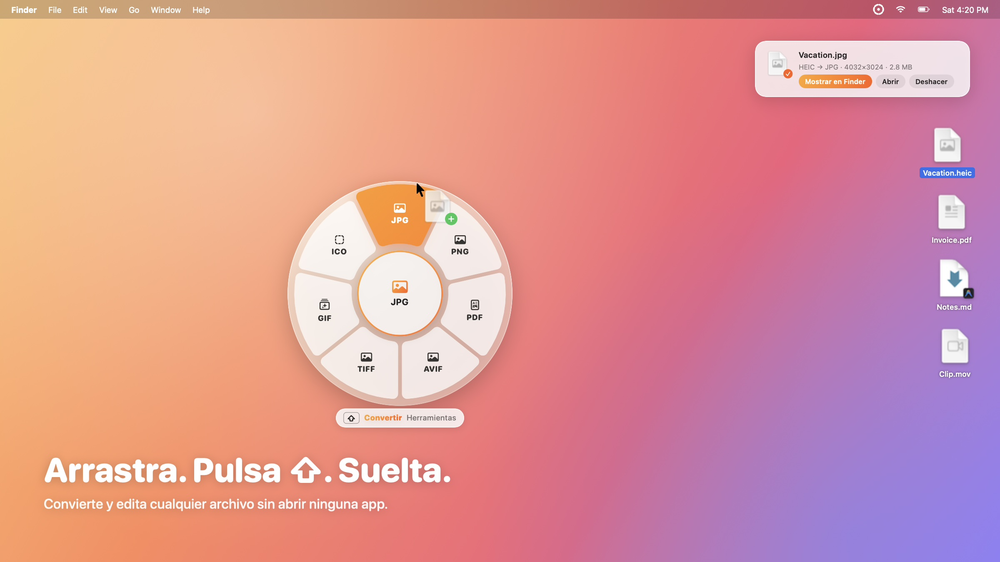
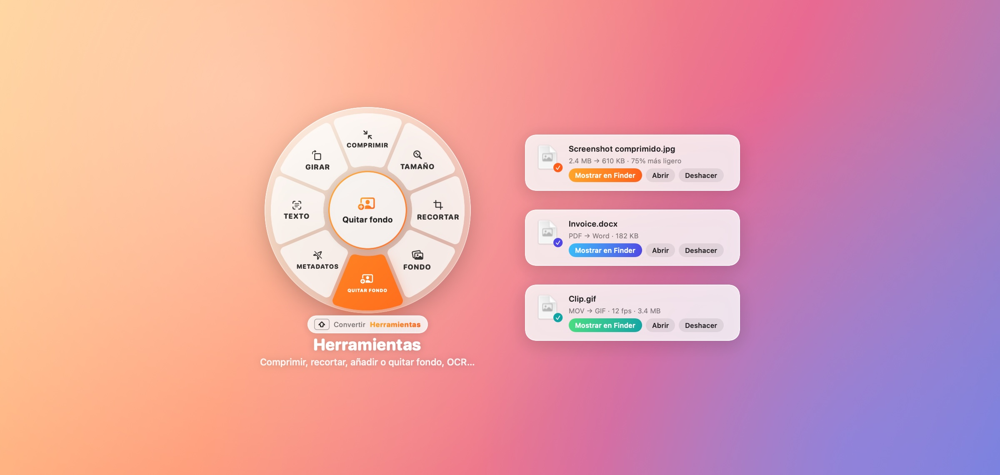

<div align="center">

[English](../../README.md) · **Español**


# Kumquat

### Agarra un archivo. Pulsa ⇧. Suéltalo sobre un formato.

**Un conversor de archivos gratuito y de código abierto que vive dentro de tu arrastrar y soltar.**<br/>
Imágenes, PDF, documentos, hojas de cálculo, e-books, vídeo, audio y archivos comprimidos, convertidos y editados sin abrir ninguna app.

[](#instalación)
[](../../Package.swift)
[](../../LICENSE)
[](https://github.com/iandifilippo/Kumquat/releases/latest)


**[Sitio web](https://iandifilippo.github.io/Kumquat/)** · [Instalación](#instalación) · [Cómo se usa](#cómo-se-usa) · [Qué convierte](#qué-convierte) · [Motores](#motores-opcionales) · [Automatización](#automatización-y-terminal) · [Preguntas](#preguntas-frecuentes)

<code>curl -fsSL https://raw.githubusercontent.com/iandifilippo/Kumquat/main/install.sh | bash</code>

<br/><br/>



</div>

---

Convertir un archivo en un Mac suele significar abrir Vista Previa, buscar *Exportar…*, elegir formato y carpeta. Kumquat lo reduce a un gesto: **agarra cualquier archivo, muévelo un poco, pulsa Mayúsculas y suéltalo sobre una porción del anillo que aparece bajo el cursor.** La copia convertida queda junto al original, que nunca se modifica.

Es una app nativa en Swift, sin dependencias. Tus archivos nunca salen de tu Mac: sin cuentas, sin subidas, sin analíticas.

**Lo más destacado:** más de 60 formatos sin instalar nada · quitar fondo y OCR en tu Mac · recortar, añadir fondo, cambiar tamaño, comprimir, unir, dividir y proteger · progreso dentro del anillo · carpetas vigiladas · comando `kumquat` · atajo ⌃⌥K para la selección de Finder · 9 idiomas · totalmente personalizable.

## Instalación

**Una línea en Terminal** (recomendado, sin avisos de seguridad):

```bash
curl -fsSL https://raw.githubusercontent.com/iandifilippo/Kumquat/main/install.sh | bash
```

Descarga la última versión, copia **Kumquat** a Aplicaciones, añade el comando `kumquat` y la abre ([ver el script](../../install.sh)). Ejecútala otra vez para actualizar, o usa **Actualizar** en la barra de menús cuando Kumquat te avise de una versión nueva.

**O descárgala tú:** baja `Kumquat-x.y.z.dmg` de la [última versión](https://github.com/iandifilippo/Kumquat/releases/latest), ábrelo y arrastra Kumquat a Aplicaciones. Es universal (Apple Silicon e Intel) y necesita **macOS 14 Sonoma o posterior**. Se abre sola al iniciar sesión (puedes desactivarlo en Ajustes).

> [!NOTE]
> **Primera apertura desde el .dmg.** Kumquat aún no está notarizada por Apple, así que macOS dice que *"no puede verificar"* la app. Ábrela una vez, pulsa **OK**, ve a **Ajustes del Sistema → Privacidad y seguridad** y pulsa **Abrir igualmente**. O ejecuta `xattr -dr com.apple.quarantine /Applications/Kumquat.app`. Todo el código está en este repositorio.

## Cómo se usa

1. **Agarra un archivo** (o varios) en Finder o en el escritorio y **muévelo un poco** sin soltar el botón o el trackpad. macOS solo empieza a arrastrar cuando el archivo se mueve.
2. **Pulsa y suelta ⇧ Mayúsculas** sin soltar el archivo. El anillo aparece al instante bajo el cursor.
3. **Suelta el archivo sobre una porción.** El centro del anillo muestra el progreso y luego un ✓. Una notificación muestra el resultado con **Mostrar en Finder**, **Abrir** y **Deshacer**.

Pulsa **⇧** otra vez mientras arrastras para cambiar entre **Convertir** y **Herramientas**. Suelta en el centro, o en cualquier otro sitio, para cancelar.

> [!TIP]
> Si no aparece nada, comprueba que el archivo se está arrastrando de verdad (ves su imagen bajo el cursor) antes de pulsar ⇧. Arrastrar directamente desde la app Fotos no funciona porque Fotos no entrega un archivo al arrastrar; saca primero la foto al escritorio.

¿Sin arrastrar? Kumquat también se abre con:

- **⌃⌥K** con archivos seleccionados en Finder
- soltando archivos sobre el **icono de la barra de menús**
- la barra de menús → **Convertir un archivo…** (y **Recientes** para encontrar lo que convertiste)
- clic derecho en Finder → **Servicios → Convert with Kumquat**
- **Abrir con → Kumquat**

<div align="center">

</div>

## Qué convierte

| Sueltas | Convertir a | Herramientas |
|---|---|---|
| **Imágenes** — HEIC, JPG, PNG, WebP, AVIF, TIFF, GIF, BMP, PSD, SVG, RAW, JPEG XL… | JPG · PNG · HEIC · AVIF · TIFF · GIF · BMP · ICO · ICNS · PSD · **PDF** (varias imágenes → un PDF) · WebP¹ | **Comprimir** · **Tamaño** · **Recortar** · **Fondo** (margen, esquinas, sombra, proporción) · **Quitar fondo** (IA en tu Mac para fotos; firmas y logos sobre papel liso también) · **Texto** (OCR, copiado al portapapeles) · **Metadatos** · Girar · Voltear · B/N · ZIP |
| **PDF** | JPG / PNG / TIFF (uno por página) · TXT · Word · EPUB · RTF · HTML | **Comprimir** (equilibrado o máximo; Ghostscript² si está) · **Unir** · **Dividir** · **Girar** · **Proteger** · **Texto** (OCR) · **Una imagen** (todas las páginas en una imagen larga) |
| **Documentos** — TXT, Markdown, RTF, Word, HTML, ODT | PDF · DOCX · EPUB · TXT · RTF · HTML · ODT | ZIP |
| **E-books** — EPUB | PDF · DOCX · TXT · HTML · RTF | ZIP |
| **Hojas de cálculo y datos** — CSV, TSV, XLSX, JSON, PLIST | XLSX · CSV · JSON · TSV · tabla HTML · tabla PDF · PLIST ↔ JSON | ZIP |
| **Subtítulos** — SRT, VTT | SRT · VTT · TXT | — |
| **Vídeo** — MOV, MP4, M4V; WebM, MKV, AVI, FLV…¹ | MP4 · MOV · **GIF** · **M4A** · M4V; MP3 · WebM · MKV · AVI¹ | **Comprimir** · **Silenciar** · **Fotogramas** (a una carpeta) |
| **Audio** — MP3, WAV, AIFF, M4A, FLAC; OGG, OPUS, WMA…¹ | M4A · WAV · AIFF · FLAC · CAF; MP3 · OGG · OPUS¹ | — |
| **Comprimidos** — ZIP, RAR, 7Z, TAR, TAR.GZ, GZ… | ZIP · TAR.GZ | **Extraer** |
| **Carpetas o una mezcla de archivos** | — | **ZIP** (imágenes + PDF también se pueden **unir** en un PDF) |
| **Office** — XLS, ODS, Numbers, PPT, PPTX, Keynote, Pages³ | PDF · XLSX · CSV · PPTX | — |

¹ necesita [FFmpeg](#motores-opcionales) (WebP: `brew install webp`) · ² [Ghostscript](#motores-opcionales) · ³ [LibreOffice](#motores-opcionales). Todo lo demás funciona sin instalar nada.

## Motores opcionales

Kumquat convierte casi todo con lo que ya trae macOS. Estas herramientas gratuitas añaden más formatos. Kumquat **nunca descarga nada**: instálalas tú y las detecta sola (Ajustes → Motores).

| Motor | Instalar | Añade |
|---|---|---|
| FFmpeg | `brew install ffmpeg` | WebM, MKV, AVI, FLV… de entrada y salida; MP3, OGG, OPUS; GIF y fotogramas de cualquier vídeo |
| WebP | `brew install webp` | Guardar imágenes como WebP |
| Ghostscript | `brew install ghostscript` | PDF mucho más ligeros con el texto seleccionable |
| LibreOffice | [libreoffice.org](https://es.libreoffice.org/descarga/) | Excel, PowerPoint, Keynote, Numbers y Pages → PDF; Word → PDF con el diseño exacto |

## Automatización y Terminal

- **Carpetas vigiladas** (Ajustes → Automatización): eliges una carpeta y una acción, por ejemplo *Convertir a JPG*. Cada archivo que llega se convierte, y el original puede ir a una subcarpeta *Originales*.
- **⌃⌥K** abre el anillo con lo que tengas seleccionado en Finder.
- **El comando `kumquat`**:

```bash
kumquat convert foto.heic --to jpg
```

```bash
kumquat watch ~/Downloads/Entrada --to pdf --move-originals
```

`kumquat help` muestra todos los comandos.

## Hazlo tuyo

<div align="center">

</div>

En **Ajustes** (barra de menús → Ajustes…) puedes cambiarlo todo, con vista previa en vivo: 8 temas o tu propio degradado, cristal esmerilado, Liquid Glass o sólido, claro u oscuro, tamaño y opacidad del anillo, etiquetas, tecla de activación (⇧ ⌥ ⌃ ⌘), qué porciones aparecen y en qué orden, dónde se guarda, la calidad, y el idioma: English, Español, Português, Français, Deutsch, Italiano, 日本語, 한국어 y 简体中文.

## Preguntas frecuentes

**¿Necesita permisos de Accesibilidad o Grabación de pantalla?** No. Detecta los arrastres con el portapapeles de arrastre del sistema y lee las teclas modificadoras sin permisos especiales. No lee la pantalla ni lo que escribes.

**¿Se sube algo a internet?** No. Usa los frameworks de Apple y los motores que tú hayas instalado. Quitar fondo y el OCR se ejecutan en tu Mac. La única conexión es comprobar si hay una versión nueva en GitHub, y se puede desactivar en Ajustes → Acerca de.

**Pulso Mayúsculas y no pasa nada.** El anillo solo aparece durante un arrastre real: presiona sobre el archivo, muévelo un poco hasta verlo bajo el cursor y entonces pulsa ⇧ sin soltar.

## Compilar desde el código

```bash
git clone https://github.com/iandifilippo/Kumquat.git
```

```bash
cd Kumquat && scripts/build-app.sh --dmg
```

## Licencia

[MIT](../../LICENSE). Gratis para usar, modificar y compartir.
